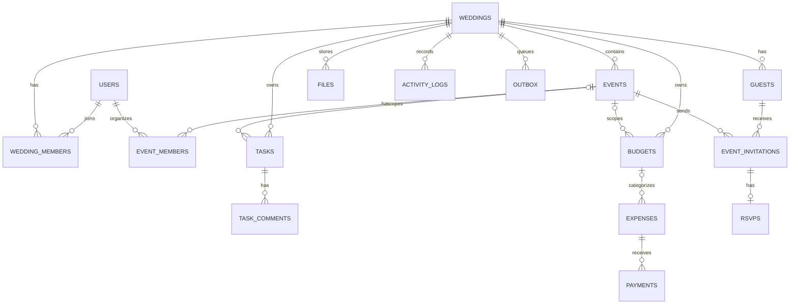

# Make My Marriage
## Database Design Document

**Version:** 1.0  
**Status:** Proposed MVP schema; implementation-ready baseline, subject to the decisions in §19  
**Database:** MongoDB Atlas  
**Application:** Next.js App Router + TypeScript + Node.js (modular monolith)  
**Related document:** Make My Marriage — System Design & Architecture v1.0  
**Default currency:** INR

---

## 1. Purpose and Scope

This document specifies the logical and physical MongoDB design for Make My Marriage, a collaborative Indian wedding-management application. It describes collections, fields, relationships, validation, indexes, access patterns, lifecycle behavior, transaction boundaries, and migration/testing requirements.

**MVP scope:** users, wedding workspaces, memberships and invitations, events and event-specific organizers, tasks, budgets, expenses, payments, wedding-wide guests, event invitations and RSVPs, notifications, files, audit activity, and reliable outbound delivery. Vendor marketplace, accommodation, seating, gallery, and advanced payment collection are future extensions.

### 1.1 Non-negotiable invariants

1. Each wedding-scoped record has a `weddingId`. Each event-scoped record has both `weddingId` and `eventId`.
2. A user may belong to many weddings, with a different role and permissions in each.
3. A guest exists once within a wedding; invitation and RSVP state is **per event**.
4. All server reads and writes enforce authenticated membership and permission checks; database indexes are not a substitute for authorization.
5. Financial ownership (`bride`, `groom`, `shared`) is different from who made a payment.
6. Money is stored as integer minor units (`amountMinor`, paise for INR), never binary floating point.
7. Files are stored in private object storage; MongoDB stores only metadata and object keys.
8. Deactivation/archival preserves history; hard deletion is a separate, controlled retention workflow.
9. Managed authentication owns login credentials and sessions; the application owns authorization.
10. Event dates/times use UTC instants plus an IANA wedding timezone; date-only values use `YYYY-MM-DD` strings.

## 2. Design Strategy

### 2.1 Database and tenancy

Use **one MongoDB database with shared collections**, tenant-partitioned logically by `weddingId`. Use a distinct Atlas database/cluster or strictly isolated environment for development, staging, and production. Do not create a database or collection per wedding for the MVP.

Every repository function accepting a wedding-scoped ID must also accept the verified `weddingId` context. For event-scoped queries, include `eventId` in the predicate. Do not rely on a browser-provided `weddingId` without checking active membership.

### 2.2 References versus embedding

- **Reference** high-growth, independently updated entities: tasks, guests, invitations, expenses, payments, activity, notifications.
- **Embed** small bounded value objects: venue address, contact details, budget allocation settings, a task checklist if modest and not separately assigned.
- **Avoid large arrays** of members, guests, payments, or comments embedded in parent documents; they cause unbounded growth and write contention.
- Denormalize only for proven read needs, with an explicit source of truth and update strategy.

### 2.3 Standard conventions

| Concern | Convention |
|---|---|
| Primary key | `_id: ObjectId` generated by MongoDB |
| Foreign keys | `ObjectId` references; MongoDB does not enforce FK constraints |
| Tenant key | `weddingId: ObjectId` on every wedding-scoped collection |
| Event key | `eventId: ObjectId` plus `weddingId` for event-scoped collections |
| Audit fields | `createdAt`, `updatedAt`: BSON Date (UTC); `createdBy`, `updatedBy` when applicable |
| Archiving | `archivedAt: Date \| null`; keep records unless retention policy calls for deletion |
| Currency | ISO 4217 `currency`, initially `INR` |
| Amounts | `*Minor: Long` / BSON int64; use JavaScript `bigint` or validated safe-integer strategy at boundaries |
| IDs in APIs | Hex ObjectId strings; convert and validate at repository boundary |
| Normalized search | Explicit normalized fields (e.g., `normalizedName`, `normalizedEmail`) |
| Enum values | Stable lowercase snake_case strings; validate on write |
| Optional values | Omit truly absent fields; use `null` only for meaningful explicit unset state |
| Schema evolution | `schemaVersion` only where useful; additive migrations preferred |

**Int64 caution:** MongoDB BSON Long is not JSON-native. Convert to string in JSON DTOs when values could exceed JavaScript safe integer limits; use a consistent conversion policy. For typical INR amounts, still enforce integer input validation.

## 3. Logical Relationship Model



**Relationship rules:** `eventInvitations` is the authoritative link between an event and a guest. Each invitation can have at most one current RSVP record. Event membership and wedding membership are separate: event membership cannot grant access to a wedding the user cannot access. References must be checked in application services to ensure they share the same `weddingId`.

## 4. Collection Inventory

| Collection | Tenant scope | Main purpose | Estimated growth |
|---|---|---|---|
| `users` | Global | App profile linked to managed identity | Per account |
| `weddings` | Root | Workspace identity and settings | Per wedding |
| `weddingMembers` | Wedding | User role, membership status, permissions | Per collaborator |
| `workspaceInvitations` | Wedding | Invite collaborators to workspace | Per invitation |
| `events` | Wedding + event | Ceremonies and other wedding events | Per event |
| `eventMembers` | Wedding + event | Event-specific organizer grants | Per organizer/event |
| `tasks` | Wedding; optional event | Planning work and assignments | Per task |
| `taskComments` | Wedding + task | Task discussion/history | Per comment |
| `budgets` | Wedding; optional event | Budget envelopes and ownership | Per budget |
| `expenses` | Wedding; optional event | Committed/actual spending | Per expense |
| `payments` | Wedding + expense | Actual payments, including partial | Per payment |
| `guests` | Wedding | Canonical guest directory | Per guest |
| `eventInvitations` | Wedding + event + guest | Event invite delivery and token | Per guest/event |
| `rsvps` | Wedding + event + guest | Current response for an event | Per invited guest/event |
| `notifications` | Wedding + recipient | In-app delivery state | Per notification |
| `files` | Wedding | Private object metadata | Per upload |
| `activityLogs` | Wedding | Append-only audit activity | Per tracked action |
| `outbox` | Wedding | Retryable outbound jobs/events | Per side effect |

Names are canonical for this document; earlier architecture drafts used `invitations` for workspace invitations. Here, **`workspaceInvitations`** distinguishes collaborator invitations from **`eventInvitations`**.

## 5. Identity and Workspace Collections

### 5.1 `users`

| Field | Type | Required | Notes |
|---|---|---|---|
| `_id` | ObjectId | Yes | Internal ID |
| `authProvider` | string | Yes | e.g. `clerk` |
| `authSubject` | string | Yes | Immutable identity-provider subject |
| `displayName` | string | Yes | 1–120 chars |
| `email` | string | No | Canonical contact, may change |
| `normalizedEmail` | string | No | Trimmed, case-normalized |
| `phoneE164` | string | No | e.g. `+91...` |
| `avatarFileId` | ObjectId | No | Optional file reference |
| `locale` | string | No | Default `en-IN` |
| `status` | enum | Yes | `active`, `disabled` |
| `createdAt`, `updatedAt` | Date | Yes | UTC |

**Unique index:** `{ authProvider: 1, authSubject: 1 }`. Do not make email the stable identity key; managed providers can support email changes and multiple sign-in methods.

### 5.2 `weddings`

| Field | Type | Required | Notes |
|---|---|---|---|
| `_id` | ObjectId | Yes | Wedding workspace ID |
| `title` | string | Yes | 1–160 chars |
| `slug` | string | No | Optional human-friendly path; not an auth boundary |
| `couple.brideUserId` | ObjectId | No | Separate account |
| `couple.groomUserId` | ObjectId | No | Separate account |
| `couple.brideDisplayName` | string | No | Display-only fallback |
| `couple.groomDisplayName` | string | No | Display-only fallback |
| `weddingDate` | string | No | `YYYY-MM-DD`, date-only |
| `timezone` | string | Yes | IANA zone, default `Asia/Kolkata` |
| `currency` | string | Yes | `INR` in MVP |
| `status` | enum | Yes | `active`, `archived` |
| `createdBy` | ObjectId | Yes | User who created workspace |
| `archivedAt` | Date | No | Archive timestamp |
| `createdAt`, `updatedAt` | Date | Yes | UTC |

Creation must atomically insert the wedding and its initial owner membership. The couple's user IDs are optional until linked; a linked couple account still needs a `weddingMembers` record to gain access.

### 5.3 `weddingMembers`

| Field | Type | Required | Notes |
|---|---|---|---|
| `_id`, `weddingId`, `userId` | ObjectId | Yes | Membership link |
| `role` | enum | Yes | `owner`, `co_owner`, `admin`, `organizer`, `contributor` |
| `status` | enum | Yes | `active`, `invited`, `suspended`, `removed` |
| `permissions` | object | Yes | Optional explicit grants/denials; see §12 |
| `joinedAt` | Date | No | First accepted date |
| `createdAt`, `updatedAt` | Date | Yes | UTC |

**Unique index:** `{ weddingId: 1, userId: 1 }`. A `guest` is not a wedding member by default; guests use invitation links and may later have an account without becoming workspace collaborators. Define owner transfer as an explicit transaction and prevent removal of the last active owner.

### 5.4 `workspaceInvitations`

Fields: `_id`, `weddingId`, `inviteeEmail`, `normalizedInviteeEmail`, `inviteePhoneE164?`, `role`, `permissions?`, `tokenHash`, `expiresAt`, `status` (`pending`, `accepted`, `revoked`, `expired`), `invitedBy`, `acceptedBy?`, `acceptedAt?`, `createdAt`, `updatedAt`.

Use cryptographically random tokens and store **only their hashes**. Validate token expiry and status on acceptance; consume token and create/activate membership atomically. Unique token-hash index. Consider a **partial unique** index on `{ weddingId, normalizedInviteeEmail }` for `status: 'pending'` only, if business rules allow one active invite per email per wedding.

## 6. Event and Task Collections

### 6.1 `events`

| Field | Type | Required | Notes |
|---|---|---|---|
| `_id`, `weddingId` | ObjectId | Yes | Tenant-scoped event |
| `name` | string | Yes | e.g. `Mehendi` |
| `category` | string | Yes | `mehendi`, `sangeet`, `haldi`, `wedding`, `reception`, `other` |
| `description` | string | No | Plain text, length limited |
| `startAt`, `endAt` | Date | No | UTC instants; `endAt >= startAt` |
| `localDate` | string | No | `YYYY-MM-DD` for calendar grouping |
| `venue` | object | No | `{ name, address, city, state, country, mapUrl? }` |
| `status` | enum | Yes | `draft`, `planned`, `completed`, `cancelled`, `archived` |
| `createdBy`, `createdAt`, `updatedAt` | mixed | Yes | Standard audit fields |

A wedding can have multiple events with the same category. No unique constraint on event name. For a time-only or tentative date, retain a separate local date/time representation rather than inventing a UTC instant.

### 6.2 `eventMembers`

Fields: `_id`, `weddingId`, `eventId`, `userId`, `role` (`lead`, `organizer`, `viewer`), `permissions`, `status` (`active`, `removed`), `createdAt`, `updatedAt`.

Unique `{ weddingId, eventId, userId }`. Only active wedding members can be active event members. Wedding-wide administrators may access events without a row here according to the authorization matrix; event membership is for additional scoped grants.

### 6.3 `tasks`

Fields: `_id`, `weddingId`, `eventId?`, `title`, `description?`, `status` (`todo`, `in_progress`, `blocked`, `done`, `cancelled`), `priority` (`low`, `medium`, `high`, `urgent`), `dueDate?` (`YYYY-MM-DD`), `dueAt?` (UTC Date for timed deadlines), `assigneeIds` (bounded array of user ObjectIds), `createdBy`, `completedAt?`, `archivedAt?`, `createdAt`, `updatedAt`.

A wedding-wide task has no `eventId`; an event task has an event reference that must belong to the same wedding. Validate that assignees are active members and authorized for the task's event. Use pagination for task lists.

### 6.4 `taskComments`

Fields: `_id`, `weddingId`, `taskId`, `authorId`, `body`, `editedAt?`, `deletedAt?`, `createdAt`, `updatedAt`. Resolve the task by `{ _id: taskId, weddingId }` before creating comments. Keep comments in a separate collection to prevent unbounded task documents.

## 7. Finance Collections

### 7.1 Finance terminology

- **Budget**: planned amount for a wedding or event, optionally split by side.
- **Expense**: a cost obligation or recorded expenditure.
- **Ownership**: who is responsible for the expense (`bride`, `groom`, `shared`).
- **Payment**: a confirmed payment against an expense, including partial payments.
- **Payer**: person/side that actually paid; not necessarily the owner.

### 7.2 `budgets`

Fields: `_id`, `weddingId`, `eventId?`, `name`, `category?`, `currency` (`INR`), `plannedAmountMinor` (int64 >= 0), `ownership` (`bride`, `groom`, `shared`), `allocations?` (`{ brideMinor, groomMinor }` when shared), `status` (`active`, `archived`), `createdBy`, `createdAt`, `updatedAt`.

**Validation:** if explicit shared allocations are supplied, their sum must equal `plannedAmountMinor`. Do not require an event budget: wedding-wide budgets are valid. Multiple budgets can exist for an event; do not infer a single total budget unless the UI explicitly aggregates them.

### 7.3 `expenses`

| Field | Type | Required | Notes |
|---|---|---|---|
| `_id`, `weddingId` | ObjectId | Yes | Tenant key |
| `eventId` | ObjectId | No | Optional event association |
| `budgetId` | ObjectId | No | Optional budget envelope |
| `title` | string | Yes | Expense label |
| `category` | string | Yes | e.g. `venue`, `catering`, `decor`, `other` |
| `amountMinor` | int64 | Yes | >= 0; agreed/recorded total |
| `currency` | string | Yes | `INR` |
| `ownership` | enum | Yes | `bride`, `groom`, `shared` |
| `ownershipSplit` | object | No | Explicit bride/groom minor-unit allocation for shared expenses |
| `incurredOn` | string | No | Date-only `YYYY-MM-DD` |
| `dueOn` | string | No | Date-only |
| `status` | enum | Yes | `planned`, `confirmed`, `cancelled` |
| `notes` | string | No | Free text, length limited |
| `receiptFileIds` | ObjectId[] | No | Bounded references to private files |
| `createdBy`, `createdAt`, `updatedAt` | mixed | Yes | Audit fields |

For shared expenses, use a validated explicit split or a clearly defined default policy. Payment status should be **derived from payment totals** rather than maintained as an independent mutable truth. Reject or explicitly handle overpayments and refunds; MVP recommendation is to reject payments exceeding the remaining balance and model refunds in a future revision.

### 7.4 `payments`

Fields: `_id`, `weddingId`, `expenseId`, `amountMinor` (int64 > 0), `currency` (`INR`), `paidOn` (`YYYY-MM-DD`), `paidAt?` (UTC Date if time known), `payerUserId?`, `payerSide?` (`bride`, `groom`, `shared`, `other`), `method?` (`cash`, `upi`, `bank_transfer`, `card`, `other`), `reference?`, `notes?`, `receiptFileId?`, `idempotencyKey?`, `createdBy`, `createdAt`, `updatedAt`, `voidedAt?`.

Payment sum excludes voided records. `balanceMinor = expense.amountMinor - sum(active payments.amountMinor)`. The server must verify `expense.weddingId == payment.weddingId` and currency match. Use a transaction or guarded aggregate update when creating concurrent payments; see §14. Payments should not be hard-deleted through routine UI actions: void with an audit reason.

### 7.5 Finance calculation rules

| Metric | Definition |
|---|---|
| Planned budget | Sum of active `budgets.plannedAmountMinor` in selected scope |
| Recorded expenses | Sum of non-cancelled `expenses.amountMinor` in selected scope |
| Paid | Sum of non-voided `payments.amountMinor` linked to included expenses |
| Outstanding | Recorded expenses minus paid, floored at zero only if overpayments are prohibited |
| Budget remaining | Planned budget minus recorded expenses; may be negative |

**Avoid double-counting:** when reporting across wedding and events, select a disjoint scope or group by the actual expense's `eventId`; never add event-level totals to a wedding total that already includes them. Budget envelopes may overlap unless the product explicitly prohibits overlap; budget summary semantics must be documented before implementation.

## 8. Guests, Invitations, and RSVP

### 8.1 `guests`

Fields: `_id`, `weddingId`, `displayName`, `normalizedName`, `phoneE164?`, `email?`, `normalizedEmail?`, `side` (`bride`, `groom`, `both`, `other`), `householdId?`, `groupLabel?`, `tags?` (bounded string array), `dietaryNotes?`, `notes?`, `status` (`active`, `archived`), `createdBy`, `createdAt`, `updatedAt`.

**Identity and duplicates:** guests are unique by `_id`, not by name. **Do not** make `{ weddingId, normalizedName }` unique: multiple people can share a name. Contact fields may be shared by families. Imports should offer duplicate *suggestions* using name + contact combinations, with user review; never silently merge records.

### 8.2 `eventInvitations`

| Field | Type | Required | Notes |
|---|---|---|---|
| `_id`, `weddingId`, `eventId`, `guestId` | ObjectId | Yes | One link per guest/event |
| `status` | enum | Yes | `draft`, `queued`, `sent`, `delivered`, `failed`, `revoked` |
| `channel` | enum | No | `email`, `sms`, `whatsapp`, `manual` |
| `tokenHash` | string | No | Hash of high-entropy RSVP token |
| `tokenExpiresAt` | Date | No | Explicit expiration policy |
| `sentAt`, `deliveredAt`, `revokedAt` | Date | No | Lifecycle timestamps |
| `invitedBy` | ObjectId | Yes | Workspace member |
| `createdAt`, `updatedAt` | Date | Yes | Audit fields |

Unique `{ weddingId, eventId, guestId }`. Unique partial index on `tokenHash` when it exists. Public token resolves exactly one event invitation, not a wedding or guest-wide permission. Tokens are revocable and rate-limited; do not expose token hashes in application responses or logs.

### 8.3 `rsvps`

Fields: `_id`, `weddingId`, `eventId`, `guestId`, `eventInvitationId`, `response` (`yes`, `no`, `maybe`), `partySize` (integer >= 0; define whether this includes the invitee), `notes?`, `respondedAt`, `updatedAt`, `responseSource` (`guest_link`, `organizer`), `updatedByUserId?`.

Unique `{ weddingId, eventId, guestId }` and unique `{ eventInvitationId: 1 }`. On write, verify all IDs match the invitation record. An RSVP for the Mehendi must **not** change the RSVP for the Reception. If edits are allowed, update the current RSVP and append a corresponding activity event; do not create multiple current RSVP documents.

**MVP policy to confirm:** whether `partySize` means the total including the invited guest, and whether organizer-defined maximum party size exists. Recommended: `partySize = total attending people including invitee`; `no` implies `partySize = 0`; `yes` implies `partySize >= 1`; `maybe` may be `0` or an estimated count.

## 9. Operational Collections

### 9.1 `notifications`

Fields: `_id`, `weddingId`, `recipientUserId`, `type`, `title`, `body`, `target` (`{ entityType, entityId }`), `readAt?`, `createdAt`, `expiresAt?`. Index recipient unread feed by `{ recipientUserId: 1, readAt: 1, createdAt: -1 }`, including `weddingId` when querying inside a workspace. A user must only see their own notifications.

### 9.2 `files`

Fields: `_id`, `weddingId`, `uploadedBy`, `objectKey`, `storageProvider`, `bucket`, `originalFilename`, `mimeType`, `sizeBytes`, `sha256?`, `purpose` (`receipt`, `avatar`, `document`, `other`), `linkedEntityType?`, `linkedEntityId?`, `status` (`pending`, `ready`, `quarantined`, `deleted`), `createdAt`, `updatedAt`, `deletedAt?`.

Use unique `{ storageProvider: 1, bucket: 1, objectKey: 1 }`. `objectKey` must not be a public URL. Authorization to read a file requires membership plus permission to read the linked resource; a valid `weddingId` alone may not suffice for financial receipts. Generate short-lived signed URLs only after access checks.

### 9.3 `activityLogs`

Fields: `_id`, `weddingId`, `actorUserId?`, `action`, `entityType`, `entityId`, `metadata` (allowlisted, redacted), `requestId?`, `createdAt`. Append-only in normal application flow. Do not log invitation tokens, secrets, payment account details, or unnecessary guest personal information. Apply a retention policy and restrict audit access.

### 9.4 `outbox`

Fields: `_id`, `weddingId`, `eventType`, `aggregateType`, `aggregateId`, `payload` (minimal and privacy-reviewed), `status` (`pending`, `processing`, `sent`, `failed`, `dead_letter`), `attempts`, `nextAttemptAt`, `lockedUntil?`, `idempotencyKey`, `lastErrorCode?`, `createdAt`, `processedAt?`.

Unique `idempotencyKey`; index `{ status: 1, nextAttemptAt: 1 }`. Worker must be safe under at-least-once delivery; email/provider calls must be idempotent where possible. Never perform email or object-storage API calls inside MongoDB transactions.

## 10. Example Documents

Examples below are **illustrative**, with placeholder ObjectIds and token hashes. They are not production secrets.

### 10.1 Wedding and event

```javascript
// weddings
{
  _id: ObjectId("66a000000000000000000001"),
  title: "Aarav & Diya Wedding",
  couple: {
    brideUserId: ObjectId("66a000000000000000000011"),
    groomUserId: ObjectId("66a000000000000000000012")
  },
  weddingDate: "2027-02-14",
  timezone: "Asia/Kolkata",
  currency: "INR",
  status: "active",
  createdBy: ObjectId("66a000000000000000000011"),
  createdAt: ISODate("2026-11-21T10:00:00Z"),
  updatedAt: ISODate("2026-11-21T10:00:00Z")
}

// events
{
  _id: ObjectId("66a000000000000000000101"),
  weddingId: ObjectId("66a000000000000000000001"),
  name: "Mehendi",
  category: "mehendi",
  localDate: "2027-02-12",
  startAt: ISODate("2027-02-12T11:30:00Z"),
  venue: { name: "Family Garden", city: "Bengaluru", state: "Karnataka", country: "India" },
  status: "planned",
  createdBy: ObjectId("66a000000000000000000011"),
  createdAt: ISODate("2026-11-21T10:05:00Z"),
  updatedAt: ISODate("2026-11-21T10:05:00Z")
}
```

### 10.2 Guest, event invitation, and RSVP

```javascript
// guests: one canonical record per wedding
{
  _id: ObjectId("66a000000000000000000201"),
  weddingId: ObjectId("66a000000000000000000001"),
  displayName: "Neha Sharma",
  normalizedName: "neha sharma",
  side: "bride",
  status: "active",
  createdBy: ObjectId("66a000000000000000000011"),
  createdAt: ISODate("2026-11-21T10:10:00Z"),
  updatedAt: ISODate("2026-11-21T10:10:00Z")
}

// eventInvitations: same guest can have a second row for Reception
{
  _id: ObjectId("66a000000000000000000301"),
  weddingId: ObjectId("66a000000000000000000001"),
  eventId: ObjectId("66a000000000000000000101"),
  guestId: ObjectId("66a000000000000000000201"),
  status: "sent",
  channel: "email",
  tokenHash: "sha256:<redacted>",
  invitedBy: ObjectId("66a000000000000000000011"),
  createdAt: ISODate("2026-11-21T10:15:00Z"),
  updatedAt: ISODate("2026-11-21T10:15:00Z")
}

// rsvps: response applies only to this event
{
  _id: ObjectId("66a000000000000000000401"),
  weddingId: ObjectId("66a000000000000000000001"),
  eventId: ObjectId("66a000000000000000000101"),
  guestId: ObjectId("66a000000000000000000201"),
  eventInvitationId: ObjectId("66a000000000000000000301"),
  response: "yes",
  partySize: 2,
  responseSource: "guest_link",
  respondedAt: ISODate("2026-11-22T09:00:00Z"),
  updatedAt: ISODate("2026-11-22T09:00:00Z")
}
```

### 10.3 Expense and partial payment

```javascript
// expenses
{
  _id: ObjectId("66a000000000000000000501"),
  weddingId: ObjectId("66a000000000000000000001"),
  eventId: ObjectId("66a000000000000000000101"),
  title: "Mehendi decorations",
  category: "decor",
  amountMinor: NumberLong("5000000"), // INR 50,000.00
  currency: "INR",
  ownership: "shared",
  ownershipSplit: { brideMinor: NumberLong("2500000"), groomMinor: NumberLong("2500000") },
  status: "confirmed",
  createdBy: ObjectId("66a000000000000000000011"),
  createdAt: ISODate("2026-11-21T10:20:00Z"),
  updatedAt: ISODate("2026-11-21T10:20:00Z")
}

// payments
{
  _id: ObjectId("66a000000000000000000601"),
  weddingId: ObjectId("66a000000000000000000001"),
  expenseId: ObjectId("66a000000000000000000501"),
  amountMinor: NumberLong("2000000"), // INR 20,000.00 paid; INR 30,000.00 outstanding
  currency: "INR",
  payerSide: "groom",
  method: "upi",
  paidOn: "2026-11-21",
  createdBy: ObjectId("66a000000000000000000012"),
  createdAt: ISODate("2026-11-21T10:25:00Z"),
  updatedAt: ISODate("2026-11-21T10:25:00Z")
}
```

## 11. Index Design

These are proposed initial indexes; validate with actual query shapes and `explain()` during implementation. `_id` indexes are implicit.

| Collection | Index keys | Unique? | Query supported |
|---|---|---|---|
| `users` | `{authProvider:1, authSubject:1}` | Yes | Identity lookup |
| `weddings` | `{createdBy:1, createdAt:-1}` | No | Created workspaces |
| `weddingMembers` | `{weddingId:1, userId:1}` | Yes | Auth and duplicate prevention |
| `weddingMembers` | `{userId:1, status:1}` | No | User's weddings |
| `workspaceInvitations` | `{tokenHash:1}` | Yes, partial | Invite acceptance |
| `workspaceInvitations` | `{weddingId:1, status:1, createdAt:-1}` | No | Pending invites |
| `events` | `{weddingId:1, startAt:1}` | No | Event timeline |
| `eventMembers` | `{weddingId:1, eventId:1, userId:1}` | Yes | Event grants |
| `tasks` | `{weddingId:1, eventId:1, status:1, dueDate:1}` | No | Event task list |
| `tasks` | `{weddingId:1, assigneeIds:1, status:1}` | No | My tasks |
| `taskComments` | `{weddingId:1, taskId:1, createdAt:1}` | No | Task discussion |
| `budgets` | `{weddingId:1, eventId:1, status:1}` | No | Budget lists |
| `expenses` | `{weddingId:1, eventId:1, incurredOn:-1}` | No | Expense ledger |
| `expenses` | `{weddingId:1, budgetId:1}` | No | Budget spend |
| `payments` | `{weddingId:1, expenseId:1, paidOn:-1}` | No | Payment history |
| `payments` | `{weddingId:1, idempotencyKey:1}` | Yes, partial | Prevent duplicate requests |
| `guests` | `{weddingId:1, normalizedName:1}` | No | Guest search |
| `guests` | `{weddingId:1, phoneE164:1}` | No | Duplicate suggestions |
| `eventInvitations` | `{weddingId:1, eventId:1, guestId:1}` | Yes | One invitation per guest/event |
| `eventInvitations` | `{tokenHash:1}` | Yes, partial | Public RSVP link |
| `rsvps` | `{weddingId:1, eventId:1, guestId:1}` | Yes | One current response |
| `rsvps` | `{eventInvitationId:1}` | Yes | Invitation response |
| `notifications` | `{recipientUserId:1, readAt:1, createdAt:-1}` | No | Inbox |
| `files` | `{storageProvider:1, bucket:1, objectKey:1}` | Yes | Object uniqueness |
| `activityLogs` | `{weddingId:1, createdAt:-1}` | No | Audit timeline |
| `outbox` | `{status:1, nextAttemptAt:1}` | No | Worker polling |
| `outbox` | `{idempotencyKey:1}` | Yes | Event deduplication |

**Partial indexes:** use `partialFilterExpression` for optional token hashes and idempotency keys to avoid uniqueness collisions on missing/null values. For user-facing text search, start with normalized prefix search and bounded pagination; evaluate Atlas Search if fuzzy search is required. Compound indexes should be tuned against production-like query profiles.

## 12. Authorization and Data Access

### 12.1 Roles and permission model

Suggested baseline roles: `owner`, `co_owner`, `admin`, `organizer`, `contributor`. A guest invitation token grants narrowly scoped RSVP access only; it does **not** create a collaborator role.

| Capability | Owner / Co-owner | Admin | Organizer | Contributor |
|---|---|---|---|---|
| Wedding settings and ownership | Full | Limited | No | No |
| Invite/manage members | Full | Configurable | No | No |
| View and manage events | Full | Full | Assigned events | Assigned events as granted |
| Create/update tasks | Full | Full | Assigned events | Assigned tasks/events |
| View financial data | Full | Permission-dependent | Permission-dependent | Permission-dependent |
| Edit budgets/expenses/payments | Full | Permission-dependent | Permission-dependent | Permission-dependent |
| Guest directory and invitations | Full | Full or configured | Assigned events | Explicit grant |

A `permissions` object can express feature grants such as `finance.view`, `finance.edit`, `guests.manage`, `events.manage`. Define precedence: **explicit deny overrides role defaults**, then explicit allow, then role default; or adopt a simpler allow-only model. Do not implement ambiguous mixed semantics. Finance reads require their own permission check even when a user can view the event.

### 12.2 Repository access pattern

```typescript
// Caller has already resolved authenticated identity and active membership.
const expense = await db.collection('expenses').findOne({
  _id: expenseId,
  weddingId: authorizedWeddingId,
  ...(eventId ? { eventId } : {})
});
```

Avoid `findOne({ _id })` for tenant data, including writes. For nested resources, verify parents belong to the same wedding before inserting children. Return a consistent not-found/forbidden policy to avoid leaking the existence of other weddings' records.

### 12.3 Public RSVP flow

1. Accept a high-entropy token over HTTPS; hash it server-side.
2. Find active `eventInvitations` by `tokenHash`; check expiry/revocation.
3. Resolve the invitation's `weddingId`, `eventId`, `guestId`; do not accept these from the caller.
4. Validate response and party-size policy; upsert only that invitation's RSVP.
5. Rate-limit and audit the operation; return minimal guest/event details.

## 13. Query and Aggregation Patterns

| Use case | Query/aggregation approach |
|---|---|
| My wedding list | `weddingMembers.find({userId, status:'active'})`, then batch-fetch weddings |
| Wedding event calendar | `events.find({weddingId, status:{$ne:'archived'}}).sort({startAt:1})` |
| Event tasks | `tasks.find({weddingId,eventId,status:...}).sort({dueDate:1,_id:1})` |
| My tasks | `tasks.find({weddingId,assigneeIds:userId,status:...})` |
| Guest directory | `guests.find({weddingId,status:'active', ...search})` with pagination |
| Invite list | `eventInvitations.find({weddingId,eventId})`, batch join guest names and RSVP status |
| RSVP counts | Aggregate `rsvps` by `{weddingId,eventId,response}` and party size; handle unanswered invitations separately |
| Event spending | Aggregate `expenses` by event and join/sum active payments by `expenseId` |
| Finance dashboard | Use separate budget, expense, payment aggregations; scope by wedding and event consistently |
| Notification inbox | `notifications.find({recipientUserId,...}).sort({createdAt:-1})` |

For large guest lists, use cursor/keyset pagination instead of deep `skip()`. Avoid N+1 queries by fetching related records in batches. For frequently viewed dashboards, first optimize aggregation/indexes; introduce materialized summaries only when measurement justifies their consistency overhead.

## 14. Transactions, Concurrency, and Idempotency

MongoDB Atlas replica sets support multi-document transactions. Keep transactions short and retry transient transaction errors according to driver guidance.

**Transaction candidates:**

1. Create wedding + initial owner membership.
2. Accept workspace invitation + activate/create membership + mark invite accepted.
3. Record payment + update any guarded summary/version used for balance enforcement + create activity/outbox record.
4. Revoke event invitation + invalidate RSVP token + append audit event when consistency is required.

**Concurrent partial payments:** reading existing payments and inserting a new one without a guard can permit overpayment under concurrent requests. Preferred MVP design: maintain an `expenses.paidAmountMinor` guarded counter **only if** it is transactionally updated alongside payment insert/void; otherwise serialize payment creation with an expense version/lock and calculate authoritative totals. If using the counter, treat `payments` as the ledger source of truth, reconcile regularly, and include the counter field in the expense schema as an explicitly derived materialization.

**Idempotency:** client supplies a unique mutation key for payment creation and invitation sends; enforce a unique index in the proper scope and return the prior result for retries. Outbox jobs must also be idempotent.

**Optimistic concurrency:** optionally add `version: int` to heavily edited documents and update with `{_id,weddingId,version}` to prevent silent lost updates. Use transaction sessions only where multi-document atomicity is necessary.

## 15. Validation and Data Integrity

Use **two layers**:

- **Application validation** (e.g., Zod): full business rules, normalization, role/permission checks, cross-document references, error messages.
- **MongoDB JSON Schema validators**: required fields, BSON types, enum ranges, basic shape and numeric constraints to protect against bypasses.

Critical checks:

- `ObjectId` validity; parent `weddingId` and `eventId` alignment.
- `startAt <= endAt` when both present.
- Nonnegative budgets/expenses; positive non-voided payment amounts.
- Currency consistency across budget/expense/payment.
- Shared allocations sum exactly to expense or budget total.
- RSVP must reference an existing invitation for the same wedding, event, and guest.
- `partySize` constraints consistent with response.
- Only active members may be task assignees/event organizers.
- Trim and length-limit text; normalize email and E.164 phone where possible.
- Token uniqueness and expiration/revocation policy.

**Important:** MongoDB does not enforce foreign keys. The application must check reference integrity and clean up dangling references through controlled workflows.

## 16. Privacy, Security, and Retention

- Use Atlas authentication, TLS, least-privilege database credentials, private network controls where available, and encrypted storage/backups.
- Separate application DB credentials from migration/admin credentials.
- Store only necessary guest personal information; restrict contact exports and audit export actions.
- Protect financial documents through finance-specific authorization.
- Hash invite tokens and redact them from logs, analytics, traces, and error reporting.
- Avoid exposing private object keys or unredacted payment references in public responses.
- Implement configurable retention for expired invites, notifications, activity logs, and abandoned uploads; avoid automatic TTL deletion of legally/audit-relevant finance records.
- Use TTL indexes only for truly disposable data and only after reviewing side effects; TTL expiration is not instantaneous.
- Document applicable Indian privacy/data-protection obligations with legal review before launch; do not assume a particular retention period without a policy decision.
- Back up Atlas and periodically test restoration; define RPO/RTO before production.

## 17. Migrations and Deployment

1. Store index definitions and schema validators as version-controlled scripts.
2. Apply additive schema changes first; deploy code compatible with both old/new shape during transitions.
3. Backfill in batches with resumable progress and monitoring.
4. Build new indexes carefully; assess index build and storage impact on production.
5. Use a migration ledger (`schemaMigrations`) with version, checksum, appliedAt, and outcome.
6. Do not edit production documents manually without a documented runbook and audit trail.
7. Use separate Atlas databases/clusters and credentials per environment.

The `schemaMigrations` collection is an operational metadata collection and does not need `weddingId`.

## 18. Testing and Acceptance Criteria

### 18.1 Required automated tests

- A user in wedding A cannot read or mutate wedding B records by changing IDs.
- User membership in two weddings applies independent roles and permissions.
- Event organizer cannot access other events unless granted.
- Finance-denied user cannot access finance API endpoints, aggregation results, or receipt URLs.
- Guest created once can be invited to multiple events; RSVP update to one leaves other events unchanged.
- Two simultaneous payment requests cannot exceed an expense balance.
- Repeating a payment request with the same idempotency key does not create a duplicate.
- Repeating invite acceptance does not create duplicate membership.
- Invalid, expired, or revoked RSVP tokens cannot update responses.
- Duplicate guest names remain separate records; imports do not silently merge.
- Budget/expense split arithmetic is exact in minor units.
- Archived wedding/event data remains available only according to authorized archive policy.
- Background worker retries do not send duplicate notifications when provider idempotency is available.
- Index definitions and validators apply cleanly to a fresh test database.

### 18.2 Performance validation

Generate representative datasets (e.g., hundreds of guests, dozens of events, thousands of task/invitation records) and test critical queries with `explain('executionStats')`. Track p95 read/write latency, examined-to-returned ratios, slow queries, index sizes, and transaction retry rates. These are test fixtures, not forecasts of production scale.

## 19. Open Decisions Before Schema Freeze

| Decision | Proposed default | Impact |
|---|---|---|
| Managed auth provider | Clerk candidate | User identity linking and webhooks |
| Guest `partySize` meaning | Total including invitee | RSVP validation and attendance sums |
| RSVP edit/expiry policy | Allow edits until event cutoff; configurable | Token and response lifecycle |
| Shared ownership split | Explicit split; otherwise 50/50 with deterministic rounding | Finance rules |
| Budget hierarchy | Independent envelopes, no automatic parent rollup | Prevent double-counting |
| Expense refunds | Out of MVP; void erroneous payments with audit | Payment ledger semantics |
| Payment balance guard | Transactional guarded counter on expense | Concurrency strategy |
| Role overrides | Explicit deny > allow > role default | Authorization consistency |
| Guest duplicate handling | Suggestions only, manual merge | Import UX and referential updates |
| Data retention/deletion | Policy and legal review pending | TTL/archival/deletion workflows |
| Event timezone changes | Wedding timezone default, per-event override later | Calendar interpretation |
| Notification channels | Email + in-app first | Outbox payload and provider adapter |

## 20. Recommended Implementation Order

1. Database connection, repository conventions, validators, migration tooling.
2. `users`, `weddings`, `weddingMembers`, `workspaceInvitations`; membership authorization tests.
3. `events`, `eventMembers`, `tasks`, `taskComments`; event scoping tests.
4. `guests`, `eventInvitations`, `rsvps`; event-isolation and token tests.
5. `budgets`, `expenses`, `payments`; exact-money and concurrency tests.
6. `files`, `notifications`, `activityLogs`, `outbox`; access controls and delivery retries.
7. Dashboard aggregations, indexes, performance checks, backup/restore runbook.

## 21. Engineering Checklist

- [ ] Every wedding-scoped collection has `weddingId` and tenant-scoped repository methods.
- [ ] Every event-scoped document carries both `weddingId` and `eventId`.
- [ ] All sensitive operations perform server-side permission checks.
- [ ] Unique indexes enforce memberships, event invitations, and current RSVPs.
- [ ] Guest identity is not conflated with event attendance.
- [ ] Amounts are exact integer minor units end to end.
- [ ] Payment concurrency and idempotency are tested.
- [ ] Public RSVP tokens are high entropy, hashed, revocable, and rate-limited.
- [ ] Files remain private and receipt access requires finance permission.
- [ ] Validators, indexes, migrations, backups, and restore tests are documented.
- [ ] Privacy and retention policies are approved before production launch.

---

## References

- [MongoDB Data Modeling](https://www.mongodb.com/docs/manual/data-modeling/)
- [MongoDB Schema Validation](https://www.mongodb.com/docs/manual/core/schema-validation/)
- [MongoDB Indexes](https://www.mongodb.com/docs/manual/indexes/)
- [MongoDB Transactions](https://www.mongodb.com/docs/manual/core/transactions/)
- [MongoDB Node.js Driver](https://www.mongodb.com/docs/drivers/node/current/)
- [MongoDB TTL Indexes](https://www.mongodb.com/docs/manual/core/index-ttl/)

**Document status:** Proposed v1.0. This is a design specification, not a claim that collections, validators, or indexes have already been deployed.
