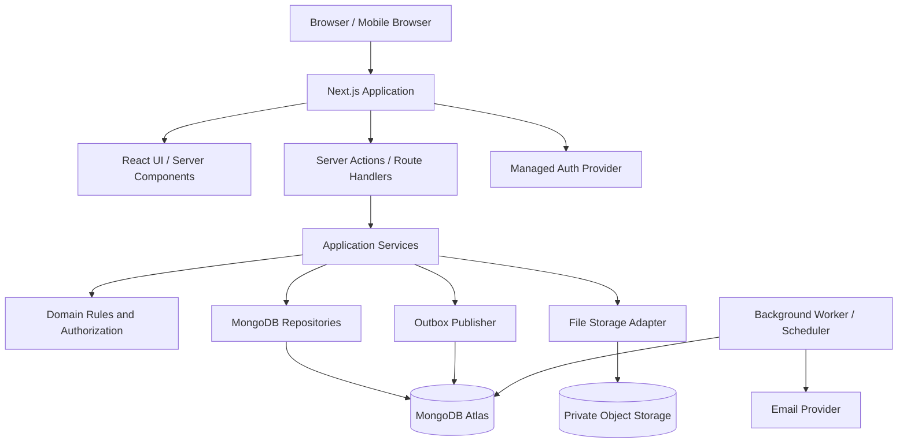
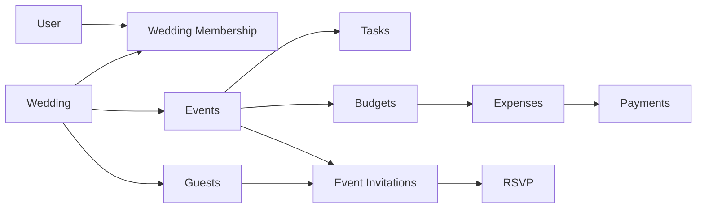

# Make My Marriage
## System Design & Architecture Document

**Version:** 1.0  
**Status:** Proposed MVP architecture  
**Product:** Responsive web application for Indian wedding management  
**Architecture style:** Modular monolith

---

## 1. Executive Summary

Make My Marriage is a family-led wedding planning workspace that consolidates events, tasks, budgets, expenses, guests, invitations, and RSVPs into one application. A single wedding can contain multiple independently managed events. The bride and groom have separate user accounts connected to the same wedding workspace; invited family members and organizers collaborate through scoped permissions.

The MVP uses **Next.js (App Router) with TypeScript and integrated Node.js backend**, **MongoDB Atlas**, a **managed identity provider**, and **private object storage** for uploaded files. The application is deployed as a **modular monolith**, avoiding distributed-system complexity while preserving clear module boundaries. Hosting, identity, storage, and email providers remain final selection decisions; Vercel is the initial hosting recommendation.

## 2. Goals and Scope

### 2.1 Goals

- Provide one secure workspace for each wedding and support users participating in multiple weddings.
- Manage events independently within the wedding, including their own organizers, tasks, budgets, guests, and RSVPs.
- Preserve wedding-wide guest records while maintaining event-specific invitations and responses.
- Track budgets, expenses, ownership by bride/groom/shared side, and partial payments.
- Support nontechnical family members through responsive, accessible interfaces.
- Establish maintainable boundaries for future vendors, accommodation, seating, gallery, and AI features.

### 2.2 MVP modules

Identity and profiles; wedding workspaces and membership; dashboard; events; tasks and organizers; budgets, expenses and payments; wedding-level guest directory and import; event invitations and RSVP; basic notifications; files and activity logs.

### 2.3 Out of scope for MVP

Real-time collaboration, advanced vendor marketplace, wedding website, transport/accommodation coordination, seating, livestream, gallery, advanced payment collection, and AI recommendations. Architecture should allow these to be added later without prematurely implementing them.

## 3. Architecture Decisions

| Concern | Decision | Rationale |
|---|---|---|
| Architecture | Modular monolith | Simpler development, deployment, and consistency for portfolio MVP |
| Frontend | Next.js App Router, React, TypeScript | Responsive UI and integrated rendering/data patterns |
| Backend | Next.js server runtime on Node.js | No separate Express/Nest service initially |
| Data store | MongoDB Atlas | Managed document database with indexes and transactions |
| Database access | Official MongoDB Node.js driver | Explicit query control and lightweight persistence layer |
| Authentication | Managed provider; Clerk is a candidate | Outsource sign-in/session security, retain app authorization |
| Hosting | Undecided; Vercel candidate | Fast Next.js delivery, evaluate limits and region |
| Files | Private S3-compatible object storage | Keep binary content outside MongoDB |
| Email | Transactional email provider, TBD | Invitations and notifications |
| Real-time | Deferred | Poll/refetch for MVP; avoid unnecessary infrastructure |
| Background delivery | Transactional outbox and worker when needed | Retryable, reliable notification processing |

## 4. High-Level System Architecture



### 4.1 Request flow

1. Browser requests a page or submits a mutation.
2. Next.js validates the session using the managed identity provider.
3. Server transport validates input and calls an application service.
4. Application service resolves wedding membership, event scope, and required permission.
5. Domain rules run; repositories access MongoDB with mandatory tenant filters.
6. The service returns a safe DTO; the UI updates. External side effects are queued where reliability matters.

**Important:** The authentication provider proves identity; Make My Marriage itself owns membership, roles, permissions, and wedding/event authorization.

## 5. Application Layers and Module Boundaries

- **Presentation:** pages, components, forms, dashboards, accessible interactions.
- **Transport:** Server Actions, API Route Handlers, request validation, error mapping.
- **Application:** use cases, orchestration, permission checks, transactions.
- **Domain:** entities, invariants, calculations, lifecycle policies.
- **Infrastructure:** MongoDB repositories, auth adapter, file storage, email, telemetry.

Suggested project structure:

```text
src/
  app/
    (public)/
    (auth)/
    (workspace)/
    api/
  modules/
    identity/
    weddings/
    events/
    tasks/
    finance/
    guests/
    invitations/
    notifications/
    files/
    audit/
  shared/
    auth/
    database/
    errors/
    validation/
    observability/
    config/
  jobs/
  tests/
```

Modules expose application-service interfaces. Avoid importing another module's internal repository or directly manipulating its collections. Shared utilities should remain small and domain-neutral.

## 6. Domain Model and Data Design

### 6.1 Multi-tenancy and identifiers

- Every wedding-scoped document contains `weddingId`.
- Every event-scoped document contains both `weddingId` and `eventId`.
- All database reads and writes enforce wedding scope; event-specific operations enforce event scope as well.
- A user may belong to several weddings with different roles.
- MongoDB ObjectIds or equivalent opaque IDs identify internal resources; IDs are never proof of access.

### 6.2 Core collections

| Collection | Important fields | Notes |
|---|---|---|
| `users` | `authProvider`, `authSubject`, `email`, `displayName`, `phone` | Maps managed auth identity to app user |
| `weddings` | `title`, `couple`, `weddingDate`, `timezone`, `createdBy`, `status` | Workspace root |
| `weddingMembers` | `weddingId`, `userId`, `role`, `status`, `permissions` | Unique wedding/user membership |
| `invitations` | `weddingId`, `email`, `role`, `tokenHash`, `expiresAt`, `status` | Collaborator invites |
| `events` | `weddingId`, `name`, `category`, `startAt`, `endAt`, `venue`, `status` | Independent wedding functions |
| `eventMembers` | `weddingId`, `eventId`, `userId`, `permissions` | Event-specific delegation |
| `tasks` | `weddingId`, `eventId`, `title`, `status`, `priority`, `dueAt`, `assigneeIds` | Event or workspace task |
| `taskComments` | `weddingId`, `taskId`, `authorId`, `body` | Collaboration history |
| `budgets` | `weddingId`, `eventId`, `plannedAmount`, `currency` | Event and aggregate planning |
| `expenses` | `weddingId`, `eventId`, `budgetId`, `amount`, `ownership`, `category`, `status` | Financial obligation |
| `payments` | `weddingId`, `expenseId`, `amount`, `paidBy`, `paidAt`, `method` | Supports partial payments |
| `guests` | `weddingId`, `name`, `phone`, `email`, `side`, `groupId`, `dietaryNotes` | One guest record per wedding |
| `eventInvitations` | `weddingId`, `eventId`, `guestId`, `inviteStatus`, `tokenHash` | Guest/event association |
| `rsvps` | `weddingId`, `eventId`, `guestId`, `response`, `partySize`, `respondedAt` | Independent per event |
| `notifications` | `weddingId`, `recipientId`, `type`, `readAt`, `createdAt` | In-app notification |
| `files` | `weddingId`, `eventId`, `storageKey`, `ownerId`, `mimeType`, `size` | Metadata only |
| `activityLogs` | `weddingId`, `actorId`, `action`, `resource`, `createdAt` | Auditable history |
| `outbox` | `weddingId`, `type`, `payload`, `status`, `nextAttemptAt` | Deferred side effects |

### 6.3 Relationships



The guest directory belongs to the wedding. The event invitation is a distinct record that joins one guest to one event. A guest's RSVP for one event cannot overwrite their response to another event.

### 6.4 Financial rules

- Store all money as integer minor units (INR paise for MVP), never floating point.
- Track `ownership` (`bride`, `groom`, `shared`) separately from `paidBy`.
- Derive outstanding balance from expense amount minus valid recorded payments.
- Define handling for refunds, corrections, and overpayment before extending the finance module.
- Financial visibility is permission-controlled in both UI and backend.

### 6.5 Date and time rules

- Store event instants in UTC and retain wedding IANA timezone (for example, `Asia/Kolkata`).
- Store date-only values as dates, not arbitrary midnight UTC timestamps.
- Normalize phone numbers to an international representation while accepting familiar Indian input formats.

### 6.6 Candidate indexes

| Collection | Index |
|---|---|
| `users` | Unique (`authProvider`, `authSubject`) |
| `weddingMembers` | Unique (`weddingId`, `userId`) |
| `events` | (`weddingId`, `startAt`) |
| `tasks` | (`weddingId`, `status`, `dueAt`) |
| `expenses` | (`weddingId`, `incurredAt`) |
| `payments` | (`weddingId`, `expenseId`, `paidAt`) |
| `guests` | (`weddingId`, `normalizedName`) for search, not necessarily unique |
| `eventInvitations` | Unique (`weddingId`, `eventId`, `guestId`) |
| `rsvps` | Unique (`weddingId`, `eventId`, `guestId`) |
| `notifications` | (`recipientId`, `readAt`, `createdAt`) |
| `activityLogs` | (`weddingId`, `createdAt`) |
| `outbox` | (`status`, `nextAttemptAt`) |

Review index selectivity and actual query patterns before adding further indexes.

### 6.7 Transactions and consistency

Use MongoDB transactions for multi-document invariants such as creating a wedding and its owner membership, accepting an invitation and activating membership, or recording a payment alongside a maintained aggregate. Keep transactions short. Never call email or object-storage services inside a database transaction; commit an outbox event instead. Prefer derived totals over denormalized counters until performance requires materialization.

## 7. Identity, Roles, and Authorization

### 7.1 Role model

| Role | Intended responsibility |
|---|---|
| Owner | Full wedding administration and ownership |
| Co-owner | Shared couple/family administration |
| Admin | Broad management subject to finance policy |
| Organizer | Event coordination within assigned scope |
| Contributor | Assigned tasks and permitted updates |
| Guest | RSVP via guest invitation; not a workspace member by default |

Permissions are explicit capabilities (for example `events.manage`, `tasks.assign`, `finance.view`, `finance.edit`, `guests.manage`, `members.invite`). Role defaults may be overridden through carefully bounded grants. Event membership can narrow access to designated events; it must not silently expand wedding-wide privileges.

### 7.2 Authorization pattern

Every protected service call must: (1) authenticate; (2) resolve current user; (3) load active membership for the requested wedding; (4) verify required permission and event scope; (5) execute a tenant-filtered repository query. Do not trust role, `weddingId`, or ownership supplied by the browser. Treat changing a URL or request ID to another wedding as a forbidden operation.

### 7.3 Public RSVP security

Use high-entropy, unguessable invitation tokens scoped to one event invitation; store token hashes, support expiration/revocation, and apply rate limits. Define whether guests can edit RSVPs and how identity is reverified. Return only the minimum guest/event information necessary.

## 8. APIs and Server-Side Interaction

Use **Server Actions** for tightly coupled UI mutations and **Route Handlers** for guest links, webhooks, uploads, external integrations, and stable versioned endpoints. Both invoke the same application services and authorization checks.

Illustrative API surface:

```text
GET    /api/v1/weddings/:weddingId
POST   /api/v1/weddings
GET    /api/v1/weddings/:weddingId/events
POST   /api/v1/weddings/:weddingId/events
PATCH  /api/v1/weddings/:weddingId/events/:eventId
GET    /api/v1/weddings/:weddingId/tasks
POST   /api/v1/weddings/:weddingId/tasks
GET    /api/v1/weddings/:weddingId/expenses
POST   /api/v1/weddings/:weddingId/expenses
POST   /api/v1/weddings/:weddingId/expenses/:expenseId/payments
GET    /api/v1/weddings/:weddingId/guests
POST   /api/v1/weddings/:weddingId/guests/import
POST   /api/v1/weddings/:weddingId/events/:eventId/invitations
GET    /api/v1/rsvp/:token
POST   /api/v1/rsvp/:token
```

Validate inputs at transport boundaries using a schema validator; return consistent error shapes and appropriate status codes (`400`, `401`, `403`, `404`, `409`, `429`, `500`). Never leak internal stack traces or reveal whether a resource exists in another tenant. Use pagination and stable sorting for large lists. For financial writes and retries, consider idempotency keys.

## 9. File Storage and Uploads

Private object storage holds photos, receipts, and documents. MongoDB stores file metadata and access scope. Recommended flow: authenticated request → permission and upload metadata validation → short-lived signed upload URL → direct upload → server-side confirmation and metadata persistence → authorized signed download URL. Validate content type, size, and extension; use unpredictable storage keys; scan potentially risky files where feasible; expire URLs quickly. Do not make the bucket public.

## 10. Notifications and Background Processing

For the MVP, notifications may be in-app and transactional email. Create notification/outbox records in the same transaction as the domain change when consistency matters. A worker or scheduled process polls pending outbox records, sends email through a provider adapter, records success, and retries failures with backoff. Use idempotent handlers and dead-letter/manual review for persistent failures. Hosting selection must account for scheduled jobs and execution limits.

## 11. Real-Time Strategy

Real-time collaboration is deferred. Use navigation refresh, server revalidation, and selective polling where needed. If future product usage requires live updates, add a managed push/WebSocket provider behind a notification interface rather than coupling domain services to a specific transport.

## 12. Security and Privacy

- Enforce authentication and authorization server-side for every protected operation.
- Include `weddingId` in all scoped queries; use `eventId` where relevant.
- Protect secrets with environment-based secret management; rotate credentials.
- Use HTTPS, secure sessions, CSRF protections appropriate to the chosen auth/transport pattern, and safe webhook signature verification.
- Apply rate limits to login-related flows, RSVP, invites, imports, and uploads.
- Restrict sensitive finance, contact, and guest data by permission; minimize collection and exposure.
- Do not log session secrets, invitation tokens, private guest details, or financial payloads.
- Define retention, export, account closure, and deletion policies; review applicable Indian data protection requirements before production.
- Keep dependency scanning and audit logs for security-sensitive actions.

## 13. Deployment and Environments

### 13.1 Proposed deployment

Next.js app deployed to a Node-capable hosting platform (Vercel is the initial candidate); MongoDB Atlas as managed data store; private object storage; managed auth; transactional email; scheduler/worker for asynchronous delivery. Keep database, storage, auth, and email behind adapters where practical to preserve hosting portability and a future Node/Docker deployment path.

### 13.2 Region and environment choices

Choose the application and Atlas regions together to minimize latency; evaluate India/Mumbai region availability, price, and service compatibility. Maintain separate local/development, staging, and production configurations and data. Never share production secrets or use real guest data in test environments.

### 13.3 CI/CD

On each change: lint, type-check, unit/integration tests, production build, dependency/security checks, and preview deployment. Before production release: database index/migration steps, smoke tests, and a rollback plan. Use environment-scoped secrets and backups with tested restore procedures.

## 14. Performance and Scalability

Target fast common-page navigation (approximately under two seconds under normal conditions, to be validated with realistic measurements). Favor server rendering where useful, paginated queries, appropriate indexes, projection of only needed fields, and caching of safe read-only data. Do not cache personalized financial or guest data across tenants. Avoid N+1 queries. Instrument slow queries, route latency, error rate, and email delivery. Scale the modular monolith vertically or through stateless instances before considering service extraction.

## 15. Observability and Operations

Capture structured application logs, request/correlation IDs, error tracking, API latency, MongoDB query latency, job queue health, outbox retry counts, and email failure metrics. Include `weddingId` only where privacy-safe and avoid raw personal data in logs. Set alerts for elevated error rates, database connection failures, and stuck notification jobs. Document backup, restore, and incident response procedures.

## 16. Testing Strategy

- **Unit:** permission evaluation, budget calculations, payment balances, RSVP transitions, date/time rules.
- **Integration:** repositories, scoped queries, indexes, MongoDB transactions, invitation acceptance.
- **End-to-end:** workspace creation, couple account joining, event setup, task assignment, expense/payment flow, guest import, event-specific invitation and RSVP.
- **Security:** unauthorized access, cross-wedding ID tampering, event-scope escalation, finance permission bypass, token reuse/revocation, upload abuse.
- **Accessibility/responsiveness:** mobile layouts, keyboard navigation, forms, errors, and screen-reader semantics.

### Release-blocking acceptance tests

1. User A cannot read or modify Wedding B by changing identifiers.
2. A member without `finance.view` cannot access financial data through either UI or API.
3. Guest RSVP for Event X does not modify RSVP for Event Y.
4. Separate bride and groom accounts can access the same wedding with appropriate permissions.
5. Partial payments correctly reduce outstanding balances without double counting.
6. Revoked or expired RSVP tokens cannot submit responses.
7. Archived wedding data remains historically intact and is protected from unauthorized mutation.
8. Private files cannot be downloaded without authorization.

## 17. Risks and Mitigations

| Risk | Mitigation |
|---|---|
| Cross-tenant data leakage | Centralized authorization, tenant-scoped repositories, adversarial tests |
| Permission complexity | Capability matrix and clear event-scope inheritance rules |
| Financial calculation errors | Integer minor units, immutable payment history where possible, tests |
| Duplicate guests/imports | Import preview, normalization, optional merge workflow |
| Email delivery failure | Transactional outbox, retries, monitoring |
| Hosting execution constraints | Verify worker/scheduler limits; keep Node portability |
| MongoDB schema drift | Runtime validation, schema versioning, controlled migrations |
| Vendor lock-in | Provider adapters, exportable data, documented deployment |
| Personal data exposure | Least privilege, private storage, retention/deletion controls |

## 18. Evolution Roadmap

**MVP:** Core modular monolith, event management, collaboration, budgets, guest directory, invitations/RSVP, basic notifications.

**Next:** Vendor management, richer payment and receipt workflows, accommodation/transport, wedding website, seating, analytics, more advanced organizer permissions.

**Later:** Realtime updates, multilingual interfaces, gallery, livestream, AI planning assistant, marketplace integrations. Extract a separate service only if independent scaling, deployment, or ownership clearly justifies it.

## 19. Open Decisions Before Production

1. Final managed authentication provider, pricing, India-oriented login methods, and export/migration support.
2. Hosting platform, plan, region, runtime and scheduled job capabilities.
3. MongoDB Atlas tier, region, backups, and connection strategy.
4. Object storage provider and signed-upload implementation.
5. Transactional email provider, sending domain, deliverability, and quotas.
6. RSVP token expiration, revocation, guest verification, and response-edit policy.
7. Data retention, deletion/export, and privacy compliance policy.
8. Exact permission matrix for owner/co-owner/admin/organizer/contributor and financial access.

## 20. Official Technical References

- [Next.js deployment](https://nextjs.org/docs/app/getting-started/deploying)
- [Next.js Route Handlers](https://nextjs.org/docs/app/getting-started/route-handlers)
- [Next.js self-hosting](https://nextjs.org/docs/pages/guides/self-hosting)
- [MongoDB Node.js transactions](https://www.mongodb.com/docs/drivers/node/current/crud/transactions/)
- [MongoDB transactions](https://www.mongodb.com/docs/manual/core/transactions/)
- [Clerk Next.js authentication reference](https://clerk.com/docs/nextjs/reference/app-router/auth)
- [Clerk Next.js quickstart](https://clerk.com/docs/nextjs/getting-started/quickstart)
- [Vercel Functions limitations](https://vercel.com/docs/functions/limitations)

---

**Document status:** Architecture proposal approved in principle; provider choices and detailed permission matrix remain open. This document should guide the next phase: detailed database schema, API contracts, and implementation planning.
